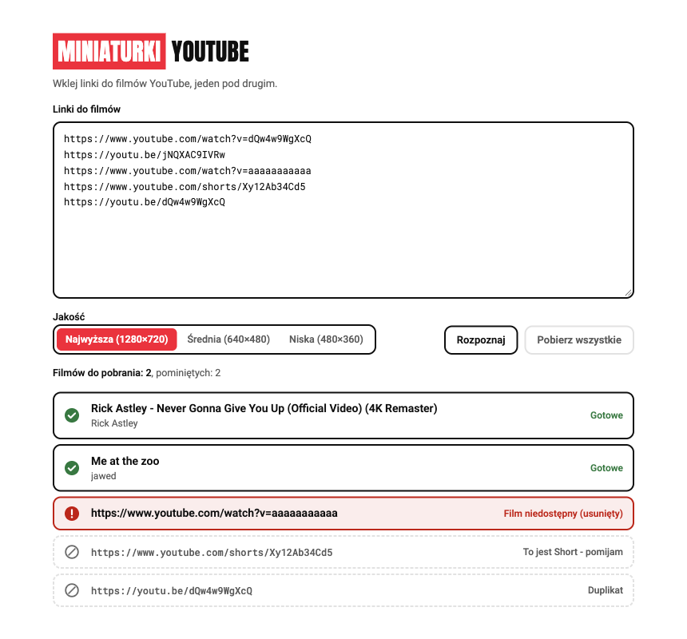
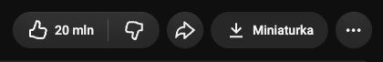
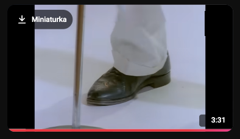
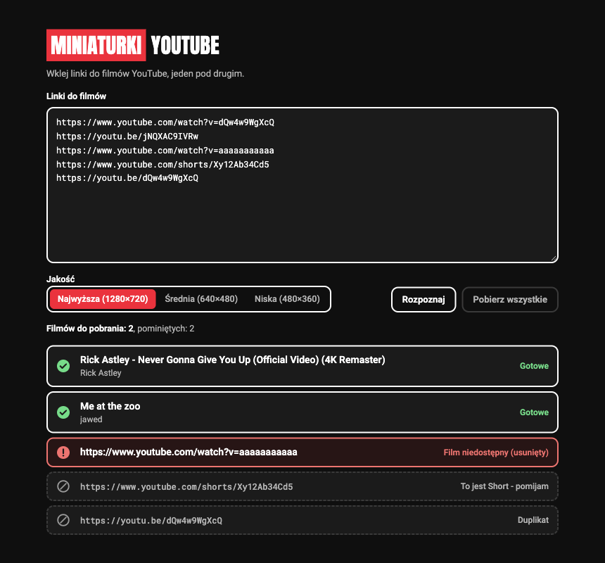

# Miniaturki YouTube

Wtyczka do przeglądarek Chrome, Brave, Arc i Edge, która pobiera Miniaturki filmów YouTube na komputer. Kliknięcie Ikony Wtyczki w pasku przeglądarki otwiera Aplikację: kartę, w którą wklejasz linki do filmów.

<p align="center">
  
</p>

Wtyczki nie ma w Chrome Web Store. Instalujesz ją sam z tego repozytorium, według instrukcji niżej (ok. 10 minut za pierwszym razem).

## Jak używać

**Na YouTube:** pod oglądanym Filmem, obok „Udostępnij”, jest przycisk „Miniaturka”. Na listach Filmów (strona główna, kanał, wyszukiwarka) ten sam przycisk pojawia się w lewym górnym rogu Miniaturki po najechaniu myszką, także gdy YouTube odtwarza podgląd wideo. Jedno kliknięcie zapisuje Miniaturkę w Pobranych. Na Shortach przycisku nie ma.

| Pod oglądanym Filmem | Na liście Filmów (podgląd wideo gra) |
|---|---|
|  |  |

**W Aplikacji** (wiele Filmów naraz):

1. Kliknij Ikonę Wtyczki w pasku przeglądarki. Otworzy się Aplikacja.
2. Wklej linki do filmów YouTube, każdy w osobnej linii (do 50).
3. Kliknij „Rozpoznaj”, sprawdź tytuły, potem „Pobierz wszystkie”. Pliki trafiają do folderu Pobrane jako `Tytuł - Kanał.jpg`.

Link do Filmu, którego nie ma na YouTube (usunięty albo błędny), Aplikacja od razu oznacza na czerwono i go nie pobiera. Shorty, linki spoza YouTube i duplikaty są pomijane.

Jakość ustawiasz przełącznikiem w Aplikacji; wybór jest zapamiętany. Średnia (640×480) i Niska (480×360) mają proporcje 4:3, więc Miniaturka 16:9 ma w nich czarne pasy u góry i u dołu - to cecha plików YouTube, nie błąd Wtyczki. To samo dotyczy starych filmów bez wersji 1280×720: Wtyczka pobiera wtedy po cichu najlepszą dostępną.

### Znane ograniczenia

- Przycisk „Miniaturka” na YouTube zależy od budowy strony YouTube (m.in. podglądu wideo po najechaniu). Gdy YouTube ją zmieni, przycisk może przestać się pokazywać, dopóki Wtyczka nie dostanie poprawki. Aplikacja (wklejanie linków) działa niezależnie od tego.

Aplikacja ma jasny i ciemny motyw, zgodnie z ustawieniem systemu:

<p align="center">
  
</p>

## Instalacja (raz)

### 1. Zainstaluj Node.js

Potrzebujesz Node.js dokładnie w wersji 22 - na nowszej `npm install` zatrzyma się z błędem. Strona [nodejs.org/download](https://nodejs.org/en/download) domyślnie podsuwa najnowszą wersję, więc w polu wyboru wersji ustaw **v22** i pobierz instalator dla swojego systemu. Po instalacji otwórz Terminal i sprawdź komendą:

```bash
node -v
```

Wynik powinien zaczynać się od `v22`.

### 2. Pobierz kod Wtyczki

Wybierz jeden sposób:

- **Bez gita:** na górze tej strony kliknij zielony przycisk **Code** → **Download ZIP**. Rozpakuj plik, np. w folderze Dokumenty. Powstanie folder `youtube-apka-miniaturki-main`.
- **Z gitem:** w Terminalu wpisz:

  ```bash
  git clone https://github.com/Szewowsky/youtube-apka-miniaturki.git
  ```

### 3. Zbuduj Wtyczkę

1. W Terminalu wejdź do folderu z kodem. Najprościej: wpisz `cd ` (ze spacją na końcu), przeciągnij folder z Findera do okna Terminala i naciśnij Enter.
2. Zainstaluj zależności:

   ```bash
   npm install
   ```

3. Zbuduj Wtyczkę. W folderze z kodem powstanie folder `dist`:

   ```bash
   npm run build
   ```

### 4. Dodaj Wtyczkę do przeglądarki

1. W pasku adresu wpisz `chrome://extensions` (w Brave `brave://extensions`, w Edge `edge://extensions`, w Arc tak jak w Chrome).
2. Włącz **Tryb dewelopera** (przełącznik w prawym górnym rogu).
3. Kliknij **Załaduj rozpakowane** i wskaż folder `dist` w folderze z kodem.
4. Przypnij Ikonę Wtyczki: kliknij ikonę puzzla w pasku przeglądarki i pinezkę przy „Miniaturki YouTube”.

Nie usuwaj ani nie przenoś folderu z kodem: przeglądarka wczytuje Wtyczkę prosto z folderu `dist`.

## Aktualizacja

Gdy w repozytorium pojawi się nowa wersja:

1. Pobierz nowy kod:
   - **Bez gita:** pobierz ZIP jeszcze raz i podmień nim stary folder (ta sama nazwa i to samo miejsce).
   - **Z gitem:** w Terminalu, w folderze z kodem:

     ```bash
     git pull
     ```

2. W folderze z kodem doinstaluj zależności i zbuduj Wtyczkę:

   ```bash
   npm install && npm run build
   ```

3. W `chrome://extensions` kliknij strzałkę **Odśwież** (okrągła strzałka) na kafelku „Miniaturki YouTube”.
4. Odśwież otwarte karty YouTube (Cmd+R). Stare karty nadal mają poprzednią wersję Wtyczki.

Po większej zmianie możesz przeklikać [listę kontrolną](docs/lista-kontrolna.md) - 32 punkty, każdy z krokiem i oczekiwanym wynikiem.

## Dla programisty

- `npm run typecheck` - sprawdzenie typów TypeScript.
- `npm run test` - testy rdzenia (Vitest).
- `npm run build` - zbudowanie Wtyczki do `dist/`.
- Bramka przed każdym oddaniem: `npm run typecheck && npm run test && npm run build`.
- Ikony Wtyczki: pliki PNG w `ikony/`, źródło `design/grafiki/ikona/ikona.svg`. Wytyczne wyglądu: [design/wytyczne.md](design/wytyczne.md).
- Słownik pojęć: [GLOSSARY.md](GLOSSARY.md). Decyzje: [docs/adr](docs/adr).

## Licencja

[MIT](LICENSE) - możesz używać, zmieniać i udostępniać dalej, zachowując informację o autorze.
